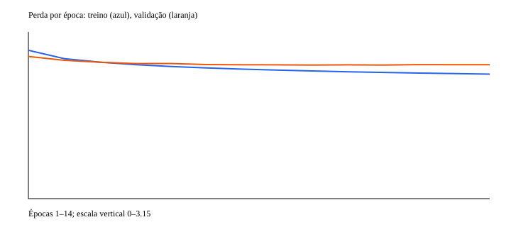

# Rede neural de xadrez: imitação de Levon Aronian

Trabalho 2 de Inteligência Artificial II — AMF, 2026/02. **Aluno: Bernardo. Modalidade 1: treinamento de rede neural própria.**

## Problema e solução

O projeto explora uma necessidade educacional: estudar padrões de decisão de um jogador a partir de suas partidas, em uma experiência interativa. Para isso, foi treinada do zero uma rede que prevê os lances do GM Levon Aronian e foi criado um tabuleiro web para jogar contra ela. O valor do protótipo é permitir experimentar a abordagem e observar seus resultados e limites; a fidelidade ao estilo do jogador ainda não foi comprovada.

## Executar o jogo

Ambiente utilizado: **Python 3.13, PyTorch e CPU**. No PowerShell:

```powershell
git clone https://github.com/Bercp/IA_G2_Rede.git
cd IA_G2_Rede
python -m venv .venv
.\.venv\Scripts\python.exe -m pip install torch==2.15.0 --index-url https://download.pytorch.org/whl/cpu
.\.venv\Scripts\python.exe -m pip install -r requirements-training.txt
.\jogar.cmd
```

O navegador abre em [http://127.0.0.1:8000](http://127.0.0.1:8000). Escolha brancas ou pretas e mova as peças por clique ou arraste. Mantenha a janela do programa aberta; **Ctrl+C** encerra o servidor. O modelo treinado acompanha o repositório, e o jogo não precisa dos PGNs nem de internet após a instalação. [Print e instruções do jogo](docs/JOGAR_WEB.md).

## Abordagem e resultados

Aprendizado supervisionado: **posição do tabuleiro → lance realizado por Aronian**. A CNN residual possui 53.216 parâmetros: entrada de 19 matrizes 8 × 8, convolução com 32 canais, dois blocos residuais e saída com 20.480 pontuações de movimentos. Uma máscara filtra os lances ilegais. O treinamento usa AdamW, entropia cruzada, lotes de 64 e taxa de aprendizado de 0,001.

Foram utilizadas 5.600 partidas públicas do [PGN Mentor](https://www.pgnmentor.com/files.html), gerando 255.570 decisões: **204.952 de treino, 24.877 de validação e 25.741 de teste**. A divisão é por partidas; posições de partidas diferentes podem se repetir. O treino encerrou por parada antecipada na época 14 e preservou o melhor modelo, da época 9.

| Recorte do teste | Top-1 | Top-3 |
| --- | ---: | ---: |
| Todas as posições | 25,45% | 45,72% |
| Após os primeiros dez lances completos | 17,85% | 36,31% |

Top-1 mede coincidência da primeira escolha com a jogada registrada; top-3 mede sua presença entre as três primeiras opções. A referência uniforme entre lances legais teria top-1 esperado de 5,02% no teste completo. Esses números não representam Elo.



A rede apresenta dificuldades diante de jogadas incomuns, inclusive ao capturar uma dama exposta. Ela escolhe pela pontuação aprendida, sem busca de variantes ou avaliação explícita de ganho material. Os exemplos e suas limitações estão na [análise de resultados](docs/RESULTADOS.md).

## Reproduzir o experimento

Depois da instalação acima, execute na raiz do projeto:

```powershell
.\.venv\Scripts\python.exe scripts\build_dataset.py
.\.venv\Scripts\python.exe scripts\verify_dataset.py
.\.venv\Scripts\python.exe -m aronian.data
.\.venv\Scripts\python.exe -m aronian.training --run runs/reproducao --epochs 30
.\.venv\Scripts\python.exe -m aronian.evaluate --run runs/reproducao
```

`runs/reproducao` deve ser uma pasta nova; o treino pode terminar antes de 30 épocas. A execução fornecida em `runs/aronian_v1` é preservada. PGNs, cache, ambiente virtual e checkpoints de retomada ficam fora do Git. A fonte pode ser atualizada: os hashes da coleta original estão registrados. Veja [dataset](docs/DATASET.md) e [treinamento e retomada](docs/TREINAMENTO_LOCAL.md).

Para verificar o código:

```powershell
.\.venv\Scripts\python.exe -m unittest discover -s tests -v
```

## Organização

- `aronian/`: codificação, rede, treino, avaliação, inferência, exportação e servidor.
- `scripts/`: coleta e verificação dos PGNs; `configs/`: configuração do treino.
- `web/dist/`: tabuleiro e peças; `tests/`: testes automatizados.
- `runs/aronian_v1/`: pesos, métricas, histórico e curva do experimento entregue.
- `reports/aronian_v1/`: metadados do dataset e sondagens táticas; `docs/`: guias e análise.

Próximos passos: ampliar a diversidade das posições e avaliar melhor a robustez tática e a fidelidade ao jogador.
