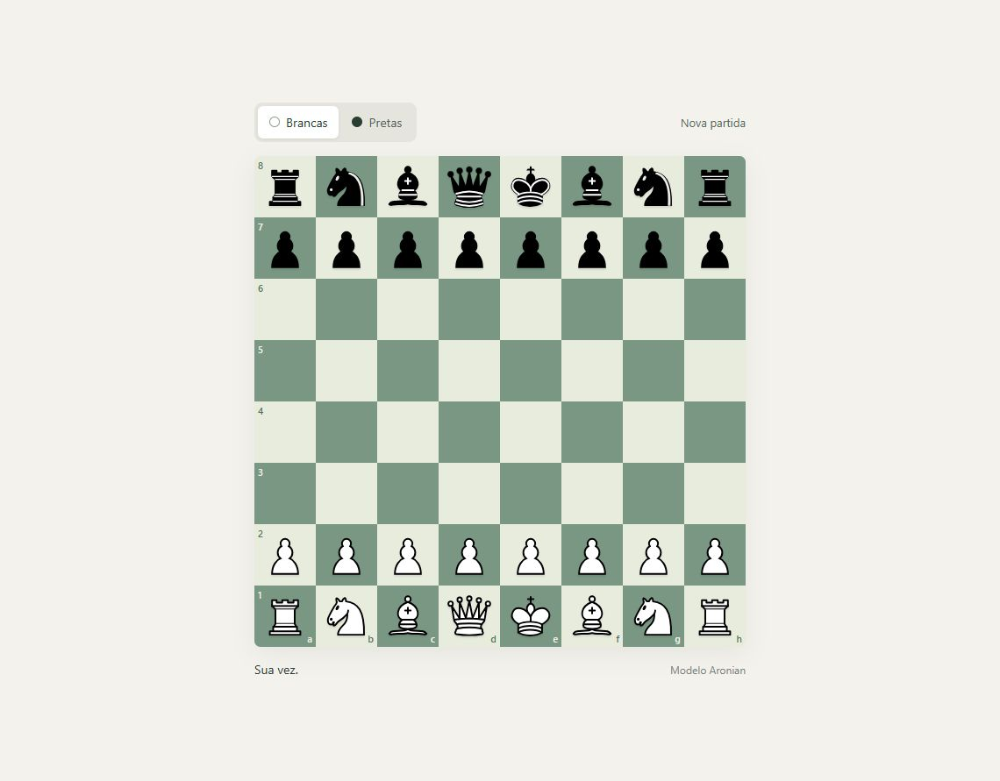

# Jogar contra o modelo no navegador



Após baixar o repositório, instale o ambiente seguindo o [README](../README.md). O modelo treinado já acompanha o projeto.

Na pasta do projeto, abra **jogar.cmd** com dois cliques. O programa carrega o modelo treinado e abre o navegador. Mantenha a janela do programa aberta enquanto joga.

No PowerShell, a partir da pasta do projeto, você também pode executar diretamente:

```powershell
.\.venv\Scripts\python.exe -m aronian.web --open
```

O endereço padrão é [http://127.0.0.1:8000](http://127.0.0.1:8000). O servidor aceita conexões somente no próprio computador. A interface, as imagens das peças e o modelo são locais; depois de instalar as dependências, o jogo não precisa de internet.

## Controles

- Escolha **Brancas** ou **Pretas**. A escolha inicia uma nova partida e posiciona suas peças na parte inferior do tabuleiro. Ao escolher pretas, o modelo faz a primeira jogada.
- Clique na peça e depois no destino, ou arraste a peça com o mouse. As casas disponíveis ficam marcadas.
- Para rocar, mova o rei duas casas. Na promoção, escolha dama, torre, bispo ou cavalo na janela que aparece.
- **Nova partida** reinicia com a cor atual.
- O texto abaixo do tabuleiro indica sua vez, xeque ou término da partida.

O sistema valida movimentos legais, capturas, roques, en passant e promoções. O histórico completo é enviado ao servidor a cada turno para preservar as regras de repetição. Empates disponíveis são reivindicados automaticamente pelo controlador.

Para encerrar o servidor, volte à janela do programa e pressione **Ctrl+C**. Se usar `jogar.cmd`, o Windows poderá pedir confirmação para encerrar o arquivo em lotes.

## Modelo utilizado

O servidor carrega uma vez, na inicialização, `runs/aronian_v1/best_weights.pt`. A execução atual usa o melhor modelo do treinamento, escolhido na época 9. A rede calcula as jogadas em CPU; o controlador filtra os lances ilegais e escolhe a ação de maior pontuação.

Para usar outro arquivo de pesos:

```powershell
.\.venv\Scripts\python.exe -m aronian.web --weights "caminho\best_weights.pt" --open
```

O comando funciona a partir de qualquer pasta quando você informa o caminho completo para o Python da `.venv`.

Se a porta 8000 já estiver ocupada, encerre a instância anterior ou escolha outra porta:

```powershell
.\.venv\Scripts\python.exe -m aronian.web --port 8001 --open
```

Nesse caso, acesse [http://127.0.0.1:8001](http://127.0.0.1:8001).

## Arquivos da interface

- `aronian/web.py`: servidor local e integração com a inferência.
- `web/dist/index.html`: tabuleiro e controles.
- `web/dist/style.css`: aparência e adaptação ao tamanho da janela.
- `web/dist/app.js`: seleção de cor, clique, arraste e comunicação com o servidor.
- `web/dist/pieces/`: peças SVG locais.

Não há dependências adicionais para a interface além do ambiente de treinamento já instalado. Os testes do servidor estão em `tests/test_web.py`.
