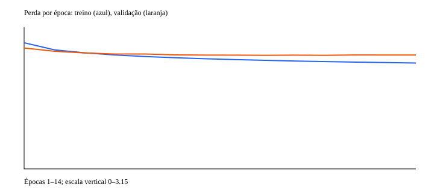

# Resultados do experimento

O objetivo foi avaliar uma rede própria que prevê lances de Levon Aronian e pode atuar como adversário interativo. A proposta foi validada com o professor. O trabalho é individual, de Bernardo; a apresentação oral será realizada após a entrega do repositório.

## Treinamento e teste

A CNN residual, inicializada do zero, possui 53.216 parâmetros. O treino em CPU usou AdamW, lotes de 64, taxa de aprendizado fixa de 0,001 e entropia cruzada com máscara de lances legais. Os hiperparâmetros completos estão em [config.json](../runs/aronian_v1/config.json).

O treinamento completou 14 épocas e 44.842 atualizações. A menor perda de validação foi 2,5798, na época 9, cujo top-1 foi 26,34%. As cinco épocas seguintes não superaram esse resultado pelo critério de melhora mínima de 0,0001, acionando a parada antecipada. O teste foi medido com os pesos selecionados pela validação.

| Recorte do teste | Posições | Perda | Top-1 | Top-3 |
| --- | ---: | ---: | ---: | ---: |
| Todas | 25.741 | 2,6109 | 25,45% | 45,72% |
| Aronian de brancas | 13.164 | 2,6609 | 23,98% | 45,02% |
| Aronian de pretas | 12.577 | 2,5587 | 26,99% | 46,45% |
| Após os primeiros dez lances completos | 20.173 | 2,9102 | 17,85% | 36,31% |

Top-1 é a coincidência da primeira escolha com a jogada registrada. Top-3 indica sua presença entre as três primeiras opções. A escolha uniforme entre movimentos legais teria top-1 esperado de 5,02% no teste completo e 5,39% no recorte após a abertura. Essa comparação é uma referência simples, não uma avaliação de força.



Os dados brutos estão em [history.json](../runs/aronian_v1/history.json), [test_metrics.json](../runs/aronian_v1/test_metrics.json), [environment.json](../runs/aronian_v1/environment.json) e [training_summary.json](../runs/aronian_v1/training_summary.json). O tempo registrado no resumo se refere àquela sessão de execução, não necessariamente à soma de todas as sessões.

## Observações nas partidas

Durante o uso da interface, observaram-se jogadas plausíveis em aberturas tradicionais e dificuldade diante de movimentos incomuns. Três sondagens diretas dos mesmos pesos documentam oportunidades de captura de dama:

| Sequência antes da decisão | Captura examinada | Ranking da captura | Probabilidade da captura | Escolha da rede |
| --- | --- | ---: | ---: | --- |
| `1. e4 e5 2. Qh5 Nc6 3. Qh4` | `Qxh4` pelas pretas | 18ª | 0,0974% | `Nf6` |
| `1. e4 e5 2. Nf3 Qh4` | `Nxh4` pelas brancas | 24ª | 0,0162% | `Bc4` |
| `1. e4 e5 2. Qh5 Nc6 3. Qxe5+` | `Nxe5` pelas pretas | 1ª | 78,71% | `Nxe5` |

As três capturas estavam disponíveis na máscara legal. As sondagens foram executadas diretamente na rede, independentemente da interface, com seleção da maior pontuação. No terceiro caso, o xeque restringe as opções legais. Os registros completos, posições, hashes dos pesos e cinco primeiras escolhas estão em [tactical_probes.json](../reports/aronian_v1/tactical_probes.json).

Para repetir sem alterar o relatório entregue:

```powershell
.\.venv\Scripts\python.exe -m aronian.probe --output data/verification/tactical_probes.json
```

São três exemplos descritivos, não uma estimativa estatística de desempenho tático. Não houve avaliação por motor de todas as alternativas. Uma probabilidade alta da rede também não comprova que uma jogada é boa.

## Interpretação e limites

Os resultados mostram capacidade de prever parte das decisões em outras partidas da coleção. A diferença entre aberturas e posições posteriores, junto das sondagens, é compatível com generalização limitada fora dos padrões aprendidos. Não foi isolada a contribuição de cada fator para as falhas.

A rede não recebe sinal explícito de ganho material e não busca respostas futuras. A biblioteca `chess` fornece legalidade e regras de término. Posições podem se repetir entre partidas das diferentes divisões. A entrada também não inclui o histórico completo. Não foi estimado um Elo nem demonstrado que os padrões sejam exclusivos do estilo de Aronian.

O valor entregue é um protótipo educacional executável, com dados, método e limitações documentados. Possíveis próximos passos incluem posições mais variadas, avaliação tática separada, comparação com outros jogadores e análise da fidelidade ao estilo. Esses passos não foram realizados nesta versão.
